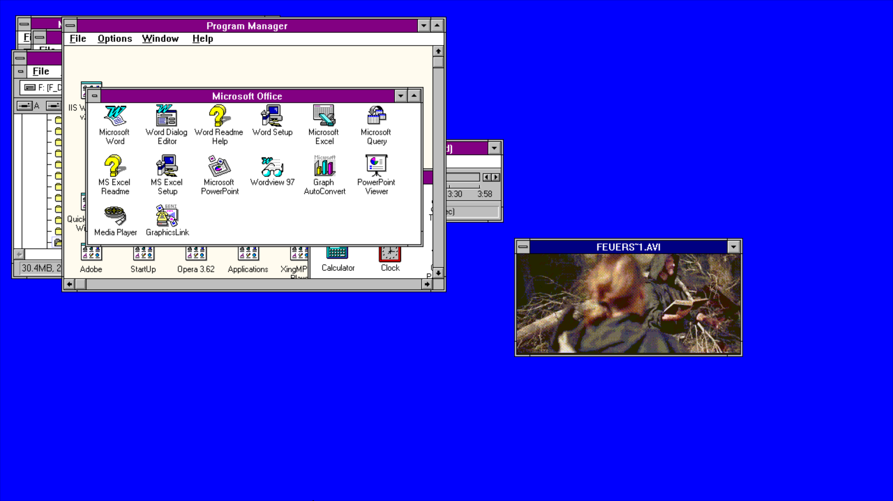
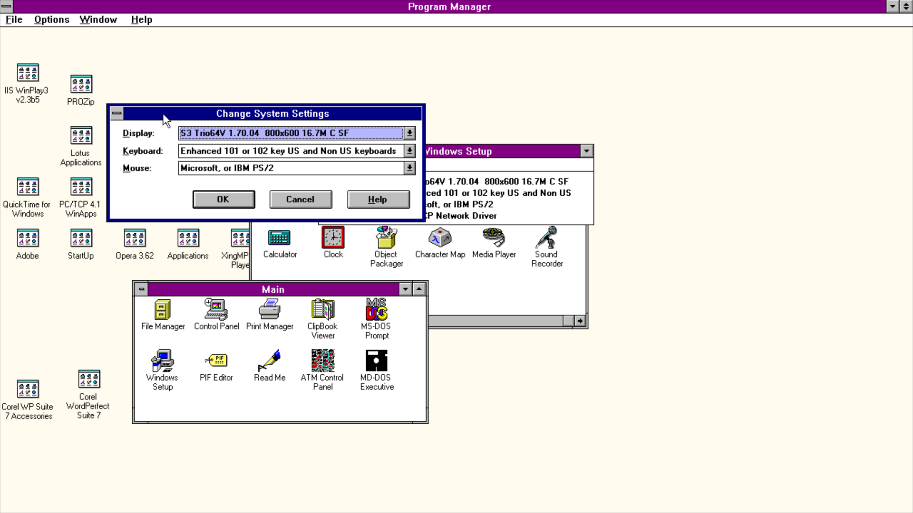
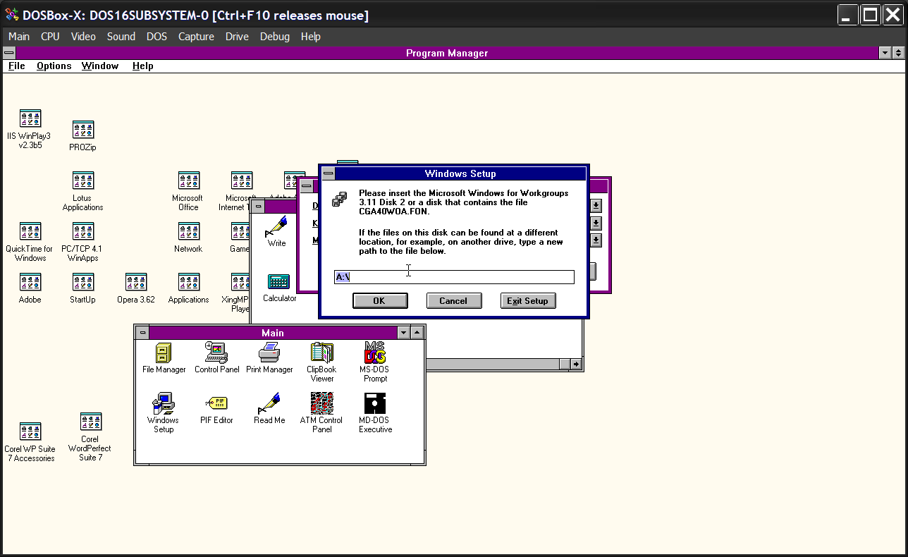
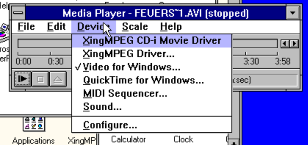

# S3Wide User Guide

Widescreen and true-colour display driver for Windows 3.1 and Windows for Workgroups 3.11, with DOSBox-X settings, full-screen video and troubleshooting.

Version 1.0 · 2 November 2026

<!-- pagebreak -->

## 1. What S3Wide is

S3Wide (`S3WIDE.DRV`) is a display driver for Windows 3.1 and Windows for Workgroups 3.11. It lets Windows run at the real resolution of a modern screen: 1280x720, 1920x1080, 2560x1440 or 3840x2160 (4K), in 256, 65,536 or 16.7 million colours. Nothing is stretched. Windows really draws every pixel at the resolution you choose, so a 16:9 monitor shows a 16:9 desktop.



### 1.1 Features

- **Widescreen and classic modes** from 640x480 up to 3840x2160. Windows Setup lists 39 ready-made entries (13 sizes at 3 colour depths).
- **256, 65K and 16M colours.** 8 bits per pixel (a fixed 256-colour set), 16 bits (5:6:5) and 32 bits (true colour).
- **Two ways to drive the card.**
  - On an S3 Trio64 asked for 1280x720 in 256 colours, S3Wide programs the S3 chip directly and uses its hardware mouse cursor.
  - Every other mode goes through the VESA BIOS (VBE 2.0 or later, linear frame buffer), with a software mouse cursor.
- **Fast bitmap and video drawing.**
  - Native StretchBlt and StretchDIBits: video in a window and enlarged pictures are scaled by the driver, about ten times faster than Windows' own scaling.
  - Uncompressed and RLE-compressed (4- and 8-bit) Windows bitmaps at every depth.
- **Full-screen DOS sessions.** Switching to a full-screen DOS program and back restores the mode and repaints the desktop.
- **Full-screen Video for Windows at the film's own shape.** The included `DISPDIB.DLL` replaces Microsoft's, so 16:9 films stay 16:9 on a 16:9 screen (see chapter 7).
- **Windows Setup support.** `OEMSETUP.INF` lets you install S3Wide from Windows Setup like any other display driver.

### 1.2 What you need

- Windows 3.1 or Windows for Workgroups 3.11, running in 386 Enhanced Mode.
- A 386 processor or later.
- Your own licensed copy of Windows. S3Wide carries the cursors, icons and window bitmaps of Windows' standard VGA driver, and the package includes the standard grabber, logo and fonts Setup installs with it; those parts belong to Microsoft.
- Either DOSBox-X (tested with version 2026.08.31) or a PC whose video BIOS offers VBE 2.0 linear-frame-buffer modes. On real hardware, S3Wide has not been tested yet.

## 2. The package

| File | What it is |
|---|---|
| `S3WIDE.DRV` | The driver |
| `OEMSETUP.INF` | Lets Windows Setup install S3Wide and list its modes |
| `DISPDIB.DLL` | Optional replacement for Video for Windows' full-screen display library (chapter 7) |
| `VBEMODES.EXE` | DOS tool that lists your machine's VESA modes and says which ones S3Wide can use |
| `INSTALL.TXT` | Short installation notes |
| `S3WIDE-GUIDE.PDF` | This guide |
| `SHA256.TXT` | Checksums of the files |
| `VGA.3GR`, `VGALOGO.LGO`, `VGALOGO.RLE` | The DOS-window grabber and start-up logo Setup installs with a VGA-style display |
| `VGASYS.FON`, `VGAFIX.FON`, `VGAOEM.FON`, `CGA40WOA.FON`, `CGA80WOA.FON`, `EGA40WOA.FON`, `EGA80WOA.FON`, `DOSAPP.FON` | The system and DOS-window fonts Setup installs with it |

Everything is ready to install: unpack the zip into one folder and run Windows Setup (3.3). The grabber, logo and font files are standard Windows for Workgroups 3.11 files, included so that Setup does not ask for Windows disks.

<!-- pagebreak -->

## 3. Installation

### 3.1 Keep a way back

Before changing the display driver, make sure you can undo it from DOS:

1. Back up `SYSTEM.INI`:

```
CD \WINDOWS
COPY SYSTEM.INI SYSTEM.BAK
```

2. If Windows does not come up with the new driver, start the machine to the DOS prompt (do not run WIN) and restore it:

```
CD \WINDOWS
COPY SYSTEM.BAK SYSTEM.INI
```

Or edit `SYSTEM.INI` with `EDIT` and set `display.drv=vga.drv` in the `[boot]` section.

### 3.2 Choose a mode with VBEMODES

At the DOS prompt (before Windows starts), list the modes your video BIOS offers:

```
C:\S3WIDE\VBEMODES > MODES.TXT
```

Each line of `MODES.TXT` is one mode, for example `MODE 112 640x480 32bpp ... s3wide=yes`. Pick a size and depth on a line that says `s3wide=yes`.

If no line says `s3wide=yes`, the BIOS has no VBE 2.0 linear frame buffer, and only the S3 Trio64 1280x720x8 mode can work. Under DOSBox-X, the modes depend on the emulated card and on the settings in chapter 4.

### 3.3 Install with Windows Setup

1. Unpack the package into one folder, for example `C:\S3WIDE`.
2. In Program Manager, open **Main**, then **Windows Setup**. Choose **Options**, **Change System Settings**.



3. Open the **Display** list and pick the last entry, **Other display (Requires disk from OEM)...**. Type the package folder (`C:\S3WIDE`) and press OK.
4. Pick an **S3Wide** entry, for example "S3Wide 1920x1080 65K colors". Use a mode VBEMODES marked `s3wide=yes`.
5. Setup may ask whether to use the current or the new driver: choose **New**.
6. Setup may ask for the "S3Wide display driver" disk or for a Windows disk (for example for `CGA40WOA.FON`). Type the package folder (`C:\S3WIDE`): the package holds those files. It may ask more than once; give the same folder each time.



7. Restart Windows when Setup offers it.

Every S3Wide entry installs the same driver with small (96 dpi) fonts. Setup writes `display.drv=s3wide.drv`, `386grabber=vga.3gr` and `display=*vddvga` into `SYSTEM.INI`, plus an `[s3wide.drv]` section with the mode. To change the mode later, run Setup again and pick another entry, or edit that section (3.5).

### 3.4 Install by hand

1. Copy `S3WIDE.DRV` into `C:\WINDOWS\SYSTEM`. It must go into `SYSTEM`, not into `C:\WINDOWS` itself.
2. Edit `C:\WINDOWS\SYSTEM.INI`:

```
[boot]
display.drv=s3wide.drv

[386Enh]
display=*vddvga

[s3wide.drv]
Width=1920
Height=1080
Depth=16
```

Leave the other `[boot]` lines (`386grabber=vga.3gr`, `oemfonts.fon=`, `fonts.fon=`, `fixedfon.fon=`) as they are for VGA. The grabber, logo and font files must be in `C:\WINDOWS\SYSTEM`: they are already there if Windows ever used its VGA driver, or you can copy them from the package folder.

3. Start Windows (`WIN`).

### 3.5 SYSTEM.INI reference

**[s3wide.drv]**, the desktop mode:

| Key | Values | Meaning |
|---|---|---|
| `Width` | pixels, e.g. 1920 | Desktop width |
| `Height` | pixels, e.g. 1080 | Desktop height |
| `Depth` | 8, 16 or 32 | 256 colours, 65,536 colours (5:6:5) or 16.7 million colours |

- Without this section, S3Wide uses 1280x720 at 8 bpp.
- An S3 Trio64 asked for 1280x720x8 is programmed directly through the S3 registers.
- Every other request needs a matching VESA mode. If the BIOS lacks the exact mode, S3Wide uses the largest mode it can draw that is no bigger than the one asked for, at the same depth if possible (on an S3 Trio64 it uses 1280x720x8 instead).

**[dispdib]**, full-screen video with the included `DISPDIB.DLL` (chapter 7):

| Key | Default | Meaning |
|---|---|---|
| `Aspect` | `16:9` | Shape of your screen. `4:3` for a 4:3 monitor or DOSBox-X with `aspect=true`, `16:10` for a 16:10 screen, `0` to keep the mode's pixels square |
| `Width`, `Height` | none | Use this 256-colour mode instead of the smallest one that fits the film (slower) |
| `Log` | `0` | `1` writes every call it receives to `C:\DISPDIB.LOG` |

<!-- pagebreak -->

## 4. DOSBox-X settings

S3Wide was developed and tested on DOSBox-X 2026.08.31. Three emulated cards are supported:

| `machine=` | Video memory | Largest modes | How S3Wide drives it |
|---|---|---|---|
| `svga_s3` (S3 Trio64, the default) | up to 16 MB | 1920x1440; 1280x720 and 1920x1080 with the high-definition options below | VESA for every mode; 1280x720x8 directly through the S3 registers |
| `svga_s3trio64` | up to 16 MB | as `svga_s3` | as `svga_s3` |
| `svga_dosbox` (DOSBox-X's own card) | up to 128 MB | 4096x3072, including 3840x2160 at 32 bpp | VESA for every mode |

For 4K use `svga_dosbox`. The emulated S3 cards stop at 16 MB of video memory and at 1920x1440, so they cannot show 3840x2160.

### 4.1 Recommended configurations

**Everyday widescreen (1920x1080, any depth) on the emulated S3.** These are the video settings of the owner's live system, where Windows for Workgroups 3.11, Word, Media Player and full-screen video were checked:

```
[dosbox]
machine=svga_s3

[video]
vmemsize=64
vesa modelist width limit=0
vesa modelist height limit=0
allow high definition vesa modes=true

[sdl]
output=direct3d

[render]
aspect=false
scaler=normal2x
autofit=true

[cpu]
cycles=auto
```

For full screen at your monitor's resolution, also set `fullscreen=true` and `fullresolution=desktop` under `[sdl]` (or press the DOSBox-X full-screen key).

**4K and true colour (3840x2160x32) on DOSBox-X's own card:**

```
[dosbox]
machine=svga_dosbox

[video]
vmemsize=64
vesa modelist width limit=0
vesa modelist height limit=0
allow high definition vesa modes=true

[render]
frameskip=10
```

**Native S3 mode (1280x720 in 256 colours, hardware cursor):**

```
[dosbox]
machine=svga_s3trio64

[video]
vmemsize=4
```

Use SYSTEM.INI `Width=1280`, `Height=720`, `Depth=8`, or no `[s3wide.drv]` section at all.

### 4.2 What each setting does

| Section | Setting | Recommended | Why |
|---|---|---|---|
| `[dosbox]` | `machine` | `svga_s3` or `svga_dosbox` | The emulated card (see the table above) |
| `[dosbox]` | `memsize` | 16 to 64 | Main memory for Windows, in MB |
| `[video]` | `vmemsize` | 64 | Video memory in MB. The S3 cards report at most 16 MB whatever you set; `svga_dosbox` uses what you give it |
| `[video]` | `vesa modelist width limit` | 0 | 0 removes DOSBox-X's width cap on the VESA mode list |
| `[video]` | `vesa modelist height limit` | 0 | 0 removes the height cap |
| `[video]` | `allow high definition vesa modes` | true | Adds the 16:9 modes (1280x720, 1920x1080, ...) to the VESA list. Without it, a 1920x1080 request falls back to a smaller mode |
| `[render]` | `aspect` | false | Shows the guest picture with square pixels. A 16:9 desktop then fills a 16:9 screen |
| `[render]` | `scaler` | `none` or `normal2x` | Doubling is not needed for 1080p and larger modes; `none` saves host time |
| `[render]` | `frameskip` | 0, or up to 10 at 4K | Skips host redraws, leaving more time to emulate at 4K on slower PCs |
| `[sdl]` | `output` | `direct3d` or `opengl` | Hardware-scaled output; `surface` gives exact pixels in a window |
| `[sdl]` | `fullscreen`, `fullresolution` | true, desktop | Full screen at your monitor's own resolution |
| `[cpu]` | `cycles` | `auto` or `max` | All drawing is done by the emulated CPU, so more cycles mean faster drawing |

### 4.3 Video memory per mode

A mode needs width x height x bytes per pixel of video memory:

| Mode | 256 colours (8 bpp) | 65K colours (16 bpp) | 16M colours (32 bpp) |
|---|---|---|---|
| 1280x720 | 0.9 MB | 1.8 MB | 3.7 MB |
| 1920x1080 | 2.1 MB | 4.1 MB | 8.3 MB |
| 2560x1440 | 3.7 MB | 7.4 MB | 14.7 MB |
| 3840x2160 | 8.3 MB | 16.6 MB | 33.2 MB |

3840x2160x32 needs `svga_dosbox` with `vmemsize=32` or more (64 recommended). Check the exact list with VBEMODES: some sizes, for example 2560x1440 or 1366x768, appear only on some cards or only with DOSBox-X's "allow unusual vesa modes" option.

<!-- pagebreak -->

## 5. Using Windows with S3Wide

### 5.1 Desktop and fonts

Windows' title bars, menus and fonts keep their usual VGA size (96 dpi small fonts), so very large modes make text small. At 1920x1080 on a full-screen monitor the size is comfortable. At 3840x2160, text is tiny unless the window is scaled up on a large screen.

### 5.2 Colours

- **16 and 32 bpp** show photos, gradients and video in full colour.
- **8 bpp** uses one fixed set of 256 colours. Programs cannot change the palette, so photos look coarser and some programs that rely on palette animation show wrong colours. Choose 16 or 32 bpp unless you need 8 bpp for an old program.

### 5.3 Pictures

Windows bitmaps (BMP and DIB) are drawn at every depth: 1, 4, 8 and 24 bits per pixel, uncompressed or RLE-compressed (4 and 8 bits). PNG, JPEG and GIF need a viewer program that understands them; Windows 3.1 itself does not.

### 5.4 Video in a window

Video for Windows plays AVI files in a window through the driver: in Media Player choose **Device**, **Configure**, then **Window**. Maximize the window or size it as you like. S3Wide stretches each frame itself in your desktop's colours, about ten times faster than Windows' own stretching.

Very large windows still cost time. At 1920x1080, each frame becomes several megabytes of video memory, which an emulated 486 or Pentium cannot fill twelve times a second. For smooth large video, use full-screen playback (chapter 7).



### 5.5 Full-screen DOS programs

You can switch to a full-screen DOS session (MS-DOS Prompt with Alt+Enter, or a full-screen PIF) and back. S3Wide gives the screen to DOS, then sets its mode again and asks Windows to repaint when you return. This was tested with a DOS session that ends by itself, on both the VESA and the S3 path. Switching with Alt+Tab uses the same mechanism but was not tested by hand. A windowed DOS box has not been tested.

## 6. Performance

All drawing is done by the processor. On the VESA path there is no 2D acceleration, so the speed depends on the emulated CPU.

- At a fixed 100,000 DOSBox-X cycles, a full-screen fill at 3840x2160x32 takes about 0.1 to 0.5 seconds.
- Stretching a 320x180 video frame to 1280x720x32 takes about 55 ms with S3Wide, against 585 ms with Windows' own stretching.
- Give DOSBox-X as many cycles as your PC allows (`cycles=auto` or `max`; `core=dynamic` is faster than the normal core).
- At 4K, `frameskip` under `[render]` leaves more time for emulation.
- 1920x1080 at 16 bpp is a good balance of colour and speed.

<!-- pagebreak -->

## 7. Full-screen video (DISPDIB.DLL)

Video for Windows' **Full Screen** option (Media Player, Device, Configure) is the fast way to play films. It does not draw through the display driver. MCIAVI hands each frame to `DISPDIB.DLL`, which switches the card to a small 256-colour mode (320x200 or 320x240) and leaves the scaling to the monitor or to DOSBox-X. A frame then costs about 64,000 bytes instead of megabytes.

### 7.1 The problem with Microsoft's DISPDIB.DLL

Microsoft's `DISPDIB.DLL` lays the film out for a 4:3 screen. A 16:9 screen (DOSBox-X full screen with `aspect=false`, or a widescreen monitor) stretches that 4:3 picture to 16:9, so a 16:9 film comes out about 21:9, far too wide.

### 7.2 The S3Wide DISPDIB.DLL

The `DISPDIB.DLL` in this package lays the film out for a 16:9 screen instead:

- A 16:9 film fills the whole screen at its own shape.
- A wider film (for example 2.22:1) gets thin black bars at the top and bottom.
- A 4:3 film gets black bars at the sides.

It uses the smallest 256-colour VESA mode that holds the film at full size (320x200 for a 320x180 film), so it is as fast as the original. It works with any display driver, not only S3Wide.


### 7.3 Installing it

1. Keep Microsoft's file:

```
CD \WINDOWS\SYSTEM
COPY DISPDIB.DLL DISPDIB.MS
```

2. Close Media Player and any other video program (or exit Windows), then copy `DISPDIB.DLL` from the package into `C:\WINDOWS\SYSTEM`.
3. Play a film and choose Full Screen. Esc or a mouse click stops it as before.

To go back, copy `DISPDIB.MS` over `DISPDIB.DLL`.

### 7.4 Settings and limits

- Set `Aspect` in `[dispdib]` to the shape of your screen (3.5). The default `16:9` suits DOSBox-X full screen on a 16:9 monitor with `aspect=false`.
- The shape is right on a full-screen display. A DOSBox-X window takes the shape of the video mode unless its size is fixed.
- Media Player refuses films bigger than its selected 320x240 or 320x200 full-screen mode before DISPDIB is called ("too big to be played in the selected VGA mode"). Play those in a window.
- If something looks wrong, set `Log=1` and look at `C:\DISPDIB.LOG`.

<!-- pagebreak -->

## 8. Troubleshooting

| Symptom | What to do |
|---|---|
| Windows does not start, or the screen stays black | From DOS, restore `SYSTEM.BAK` or set `display.drv=vga.drv` (3.1). Check the mode with VBEMODES and the DOSBox-X options (chapter 4) |
| The desktop is smaller than the mode you asked for | The BIOS lacks that mode and S3Wide fell back to a smaller one. On DOSBox-X, enable `allow high definition vesa modes` and the two `vesa modelist ... limit=0` options, and check VBEMODES |
| Setup asks for a Windows disk or the "S3Wide display driver" disk | Type the package folder (`C:\S3WIDE`) |
| Windows does not use S3Wide after a manual install | `S3WIDE.DRV` must be in `C:\WINDOWS\SYSTEM`, not `C:\WINDOWS` |
| Colours look coarse | You are at 8 bpp, which uses a fixed 256-colour set. Use 16 or 32 bpp |
| Full-screen video is stretched too wide | Install the S3Wide `DISPDIB.DLL` (chapter 7) |
| Full-screen video shows bars at the top and bottom | The film is wider than 16:9 (for example 2.22:1); that is its real shape |
| Full-screen video does not start | Restore `DISPDIB.MS`, or set `Log=1` in `[dispdib]` and look at `C:\DISPDIB.LOG` |
| Drawing is slow at 4K | Raise DOSBox-X cycles, use `frameskip`, or pick 1920x1080 |

### 8.1 Reporting a problem

Please note:

- the DOSBox-X version and your configuration file, or your PC and video card
- your SYSTEM.INI `[boot]` and `[s3wide.drv]` sections
- the `VBEMODES` output
- what you did and what you saw (a screenshot helps)

A tracing build of the driver that logs its calls to `C:\S3TRACE.TXT` can be made for diagnosis (chapter 10).

## 9. Known limits

- Real hardware has not been tested.
- There is no 2D acceleration on the VESA path.
- 15-bit (5:5:5) and 24-bit packed modes are not used.
- At 8 bpp the palette is fixed.
- Device fonts are not provided; Windows uses its own system fonts.
- A windowed DOS box, and switching to DOS with Alt+Tab, have not been tested.
- Full-screen video was tested with Media Player and Indeo 4 films on the owner's system. Moving the mouse during full-screen playback was not specifically tested.

<!-- pagebreak -->

## 10. For developers

### 10.1 Building

Building needs:

- Open Watcom 2 (16-bit compiler, linker and resource compiler)
- a host C compiler (gcc or clang) for the driver's host tests
- Python 3
- a POSIX shell (Git Bash on Windows)

```
export WATCOM=C:/WATCOM OWBIN=binnt64 CC=clang PYTHON=python
VGA_DRV=C:/WINDOWS/SYSTEM/VGA.DRV sh ./build.sh   # build/s3wide_driver.dll + host tests
sh dispdib/build.sh               # build/DISPDIB.DLL
sh tests/win16/build-win16-probes.sh
WINSYS=C:/WINDOWS/SYSTEM sh package/make-package.sh build/s3wide_driver.dll 1.0.0
```

- `build.sh` needs `VGA_DRV=path\to\VGA.DRV`: a Windows display driver must carry the cursors, icons and window bitmaps USER loads from it, and the build takes them from that file. Without it, the result (S3WIDE.BIN) has only its version resource and Windows cannot start with it.
- `package/make-package.sh DRIVER VERSION` with `WINSYS=` (a Windows `SYSTEM` folder) makes the ready-to-install zip with the grabber, logo and fonts.
- `S3_TRACE=1` makes the tracing build, which logs to `C:\S3TRACE.TXT`.

### 10.2 Source layout

| Path | Contents |
|---|---|
| `src/s3_exports.c`, `s3_dda_entries.c`, `s3_gdi_stubs.c` | Driver entry points (Enable, Disable, BitBlt, Output, ExtTextOut, cursor, stretching) |
| `src/s3_mode.c`, `s3_vbe.c`, `s3_hw.c`, `s3_win16_hw.c` | Mode choice, VESA BIOS calls, S3 register programming |
| `src/s3_raster.c`, `s3_copy.c`, `s3_brush.c`, `s3_output.c`, `s3_text.c` | Drawing: raster operations, fills, lines, text |
| `src/s3_dib.c` | Device-independent bitmaps, RLE decoding, StretchDIBits |
| `src/s3_cursor.c`, `s3_swcursor.c` | Hardware and software mouse cursors |
| `src/s3_switch.c` | Full-screen DOS switching (INT 2Fh) |
| `dispdib/` | The replacement DISPDIB.DLL |
| `tools/s3prep/` | S3PREP (developer tool, see 10.4) |
| `package/` | OEMSETUP.INF generator, INSTALL.TXT, packaging scripts |
| `tests/` | Host tests, Win16 probes, DOSBox-X test runner |
| `docs/research/` | Measurements and design notes for each change |

### 10.3 Testing

- `tests/host_test.c` runs on the host as part of `build.sh`.
- The Win16 probes in `tests/win16/` run inside a disposable copy of a Windows guest, started by `tests/win16/run-display-baseline.sh`.
- The probes include `DISPBASE` (desktop readback), `DISPRLE` (RLE bitmaps), `DISPSTR` and `DISPSMAP` (stretching), `DIBROWS` and `DISPHUGE` (bitmap rows), `DISPBNCH` (timing) and `DDPLAY` (DISPDIB).
- Each probe compares the driver's output with GDI's own results or with the emulator's picture.
- `docs/research/` records every result with its configuration.

### 10.4 S3PREP

`tools/s3prep/` builds `S3PREP.EXE`, a DOS tool that turns a driver built without `VGA_DRV` (`S3WIDE.BIN`) into `S3WIDE.DRV` using a given `VGA.DRV`, for example on a machine without the build tools: `S3PREP C:\WINDOWS` with `S3WIDE.BIN` beside it. `S3WIDE.BIN` is a complete driver whose resource table holds only its version information. S3PREP rewrites the file's NE header with a new resource table: the driver's version resource, followed by every resource of `VGA.DRV` except its version (11 cursors, 5 icons with 13 images, 34 bitmaps, and the OEMBIN and STRINGS tables: 79 resources). It then copies the code segments with their relocations, followed by the resource data.

The result matches a driver linked with those resources: the same segments, entry table, names and resource data.
